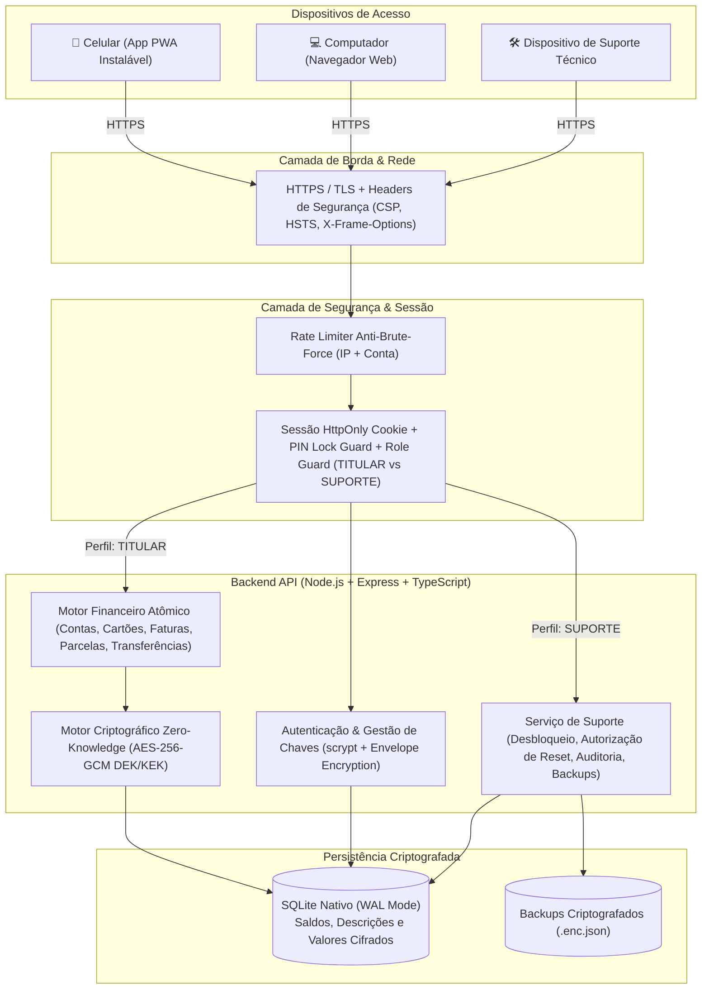
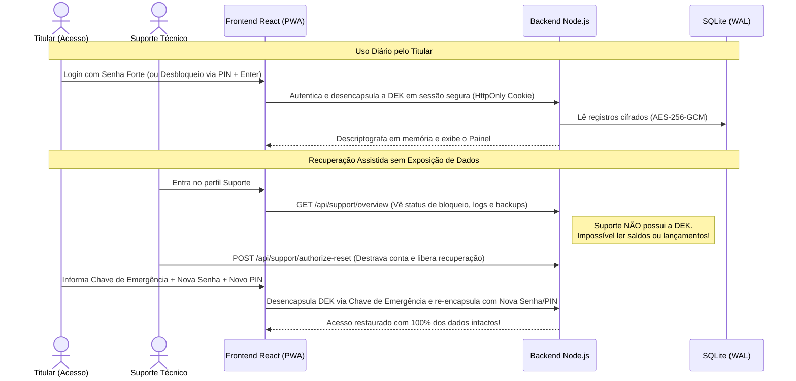
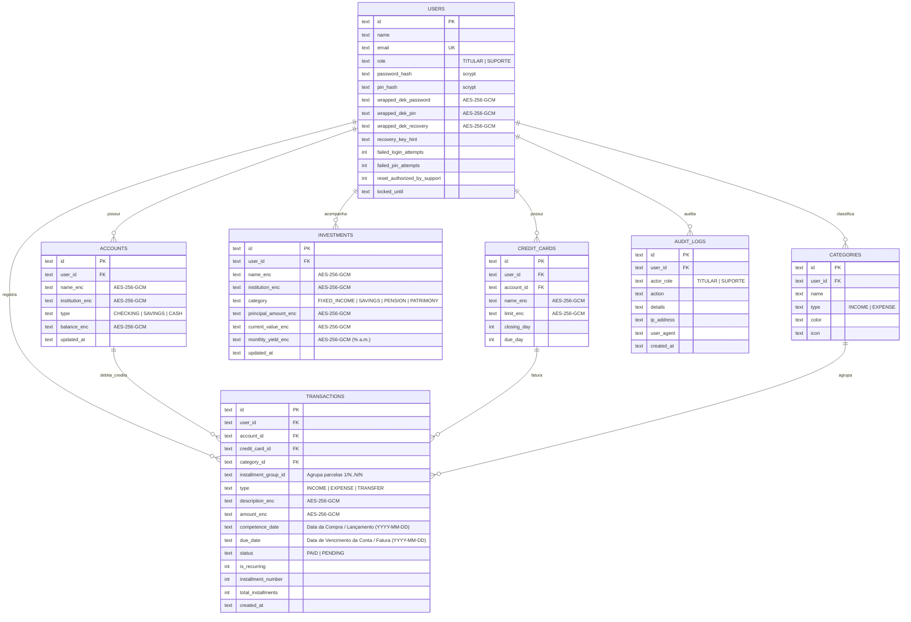

# 🛡️ LK Finanças — Cofre Pessoal & Patrimonial (Zero-Knowledge)

Sistema web completo (Desktop + Mobile PWA instalável) de gestão financeira pessoal, familiar e patrimonial com arquitetura **Zero-Knowledge (Envelope Encryption `AES-256-GCM` + `scrypt`)**, banco de dados **SQLite nativo em modo WAL (`node:sqlite`)** e segregação estrita entre o perfil **Acesso (Titular)** e o perfil **Suporte Técnico**.

---

## 📑 Índice

1. [Arquitetura em Camadas](#-1-arquitetura-em-camadas)
2. [Segurança Zero-Knowledge & Envelope Encryption](#-2-segurança-zero-knowledge--envelope-encryption)
3. [Modelagem do Banco de Dados (ERD)](#-3-modelagem-do-banco-de-dados-erd)
4. [Módulos e Funcionalidades do Sistema](#-4-módulos-e-funcionalidades-do-sistema)
5. [Referência de Rotas da API REST](#-5-referência-de-rotas-da-api-rest)
6. [Estrutura do Projeto](#-6-estrutura-do-projeto)
7. [Como Executar Localmente](#-7-como-executar-localmente)
8. [Deploy com Docker ou Render](#-8-deploy-com-docker-ou-render)

---

## 🏗️ 1. Arquitetura em Camadas



---

## 🔐 2. Segurança Zero-Knowledge & Envelope Encryption

Todos os dados financeiros sensíveis (saldos bancários, nomes de contas, limites de cartões, descrições de compras, valores de lançamentos e aplicações) são criptografados com uma **Chave Mestra de Dados (`DEK` de 256 bits — `AES-256-GCM`)** exclusiva do titular.

**A `DEK` nunca é gravada em texto puro no banco de dados nem nos backups.**

### As 3 Cápsulas Criptográficas (`KEKs`):

1. **Cápsula 1 — Senha Forte (`wrapped_dek_password`)**:
   - A `DEK` é cifrada com uma chave derivada da Senha Principal via `scrypt` (`N=16384, r=8, p=1`, Salt aleatório de 128 bits e IV de 96 bits + AuthTag GCM de 128 bits).
2. **Cápsula 2 — PIN Rápido de 4 a 6 dígitos (`wrapped_dek_pin`)**:
   - Permite bloquear a tela imediatamente (botão **Bloquear PIN** ou bloqueio automático após **3 minutos de inatividade**) limpando a `DEK` da memória RAM da sessão, e reabri-la digitando o PIN numérico no teclado + `Enter`.
   - Após **3 tentativas incorretas de PIN**, a sessão inteira é invalidada e exige novo login com a Senha Principal.
3. **Cápsula 3 — Chave de Recuperação de Emergência (`wrapped_dek_recovery`)**:
   - Gerada no primeiro uso (`LK-XXXX-XXXX-XXXX-XXXX`).
   - Caso o titular esqueça a senha, o perfil **Suporte** pode destravar a conta e autorizar a redefinição (`reset_authorized_by_support = 1`), permitindo que o titular use sua Chave de Emergência para re-encapsular a `DEK` com uma nova senha **sem perder nenhum dado e sem que o Suporte jamais visualize os valores**.



---

## 🗄️ 3. Modelagem do Banco de Dados (ERD)



---

## ✨ 4. Módulos e Funcionalidades do Sistema

### Barra Superior & Segurança Rápida
- **Modo Escuro Fixo de Alto Contraste**: Desenvolvido para leitura confortável e clara em qualquer ambiente.
- **Olho Mágico (Modo Privacidade)**: Ícone de olho no topo que oculta/exibe instantaneamente todos os valores monetários e percentuais da tela (`R$ •••••`).
- **Bloquear (PIN)**: Trava a tela na hora (e também bloqueia sozinho após 3 minutos sem uso). Na tela de PIN, basta digitar os números direto no teclado e pressionar `Enter`.

### 1. Visão Geral (`OVERVIEW`)
- **Alertas de Vencimento**: Quadro de destaque para contas pendentes vencidas ou que vencem nos próximos **7 dias**, com botão **Dar Baixa (Pago)** em 1 clique.
- **4 Indicadores Principais**:
  1. Saldo Disponível em Contas
  2. Investimentos & Reserva (com rendimento médio mensal em `%`)
  3. Entradas do Mês (com comparativo automático em relação ao mês anterior)
  4. Despesas do Mês (total pago, total pendente e comparativo automático em `R$` e `%` vs. mês anterior)
- **Patrimônio Líquido Consolidado**: Soma criptografada de todas as contas + investimentos.
- **Balanço do Mês ("Sobrou / Faltou")**: Mostra quanto sobrou livre (ou faltou) no mês e a barra percentual de comprometimento das entradas.
- **Gráfico de Gastos por Categoria**: Barras de progresso ordenadas pelas maiores despesas do mês.

### 2. Contas & Parcelas (`TRANSACTIONS`)
- **Datas Separadas para Compras no Cartão de Crédito**:
  - Ao escolher **Cartão de Crédito**, o formulário exibe lado a lado:
    1. **Data da Compra (Lançamento)** (`competence_date`)
    2. **Vencimento da Fatura** (`due_date` — calculado automaticamente conforme o dia de fechamento e vencimento do cartão, podendo também ser ajustado manualmente sem projeção duplicada).
- **Modalidades de Lançamento**:
  - **À Vista / Único**
  - **Parcelado (`2x` a `48x`)**: divide o valor total em parcelas mensais exatas (ajustando automaticamente a diferença de centavos na última parcela).
  - **Conta Fixa Mensal**: projeta automaticamente para os próximos 3, 6 ou 12 meses.
- **Campo de Categoria em Lista Suspensa (`<select>`)**:
  - Ao cadastrar uma nova categoria (`+ Cadastrar`), a caixa de texto se oculta automaticamente e a categoria fica guardada na lista suspensa (igual ao seletor de Conta Corrente), mantendo o formulário limpo.
- **Situação Separada nas 4 Opções**:
  - Tanto no campo **Situação** do formulário quanto nos **Filtros Rápidos** e nos botões de cada lançamento, os status são separados em:
    - `✓ Recebido` (Entrada concluída)
    - `✓ Pago` (Saída/Conta quitada)
    - `⏳ A Receber` (Entrada prevista)
    - `⏳ A Pagar` (Saída/Conta ou compra de cartão em aberto)
- **Visibilidade Cruzada de Compras de Cartão**:
  - Compras feitas em um mês (ex: Outubro) com vencimento no mês seguinte (ex: Novembro) aparecem normalmente na fatura de Novembro (`Compra em: DD/MM/AAAA • Vencimento Fatura: DD/MM/AAAA`) e também contam com um quadro informativo no mês da compra para consulta imediata.

### 3. Bancos & Cartões (`ACCOUNTS_CARDS`)
- **Transferências, Aportes e Resgates em 1 Clique**:
  - Entre Contas Bancárias / Carteira (`ACCOUNT_TO_ACCOUNT`)
  - Aplicar: Conta → Investimento (`ACCOUNT_TO_INVESTMENT`)
  - Resgatar: Investimento → Conta (`INVESTMENT_TO_ACCOUNT`)
- **Gestão Completa de Contas e Cartões**: Cadastro, edição inline (`Pencil`) e remoção (`Trash2`).
- **Quitação de Fatura e Compras do Cartão de Crédito**:
  - Botão em destaque **`✓ Quitar / Pagar Cartão`** direto no card do cartão para dar baixa em toda a fatura do mês (com opção de descontar automaticamente o valor do saldo de uma conta bancária ou apenas marcar como pago).
  - Relatório expansível **`📋 Ver Relatório do Cartão`** com filtros por **Vencimento da Fatura**, **Mês da Compra** ou **Todas as Compras**, exibindo **Data da Compra (Lançamento)**, **Vencimento da Fatura**, botão individual **`✓ Quitar / Pagar`**, exportação para **Excel (CSV)** e impressão/geração de **PDF**.

### 4. Investimentos & Patrimônio (`INVESTMENTS`)
- Controle de aplicações (**Renda Fixa / CDB / Tesouro**, **Poupança**, **Previdência** e **Imóveis / Bens**), exibindo Valor Aplicado, Saldo Bruto Atual, Evolução Acumulada e Rentabilidade Mensal em **porcentagem (`% a.m.`)**.

---

## 🔌 5. Referência de Rotas da API REST

| Método | Rota | Perfil | Descrição |
| :--- | :--- | :--- | :--- |
| `POST` | `/api/auth/login` | Público | Autentica `TITULAR` ou `SUPORTE`, desencapsula `DEK` na sessão e emite cookie `HttpOnly` |
| `POST` | `/api/auth/logout` | Autenticado | Limpa a `DEK` da memória e encerra a sessão |
| `GET` | `/api/auth/me` | Autenticado | Retorna perfil logado e estado do bloqueio por PIN |
| `POST` | `/api/auth/lock-pin` | `TITULAR` | Limpa a `DEK` da memória RAM e trava a tela exigindo PIN |
| `POST` | `/api/auth/unlock-pin` | `TITULAR` | Desencapsula `DEK` usando o PIN numérico (máx. 3 tentativas) |
| `POST` | `/api/auth/recover` | Público | Redefine senha/PIN com a Chave de Emergência quando autorizado pelo Suporte |
| `GET` | `/api/finance/overview?month=YYYY-MM` | `TITULAR` | Retorna resumo patrimonial, contas, cartões, investimentos e lançamentos do mês |
| `POST` | `/api/finance/transactions` | `TITULAR` | Cria lançamento único, parcelado ou recorrente com `purchaseDate` e `dueDate` |
| `PUT` | `/api/finance/transactions/:id` | `TITULAR` | Atualiza descrição, valor, datas, categoria e situação (ajustando saldo bancário) |
| `PATCH` | `/api/finance/transactions/:id/status` | `TITULAR` | Alterna entre `Recebido`/`A Receber` ou `Pago`/`A Pagar` atualizando o saldo |
| `DELETE` | `/api/finance/transactions/:id` | `TITULAR` | Exclui lançamento individual ou todas as parcelas do grupo (`?deleteGroup=true`) |
| `POST` | `/api/finance/credit-cards/:id/pay-invoice` | `TITULAR` | Quita todas as compras pendentes da fatura do cartão (com débito opcional em conta) |
| `POST` | `/api/finance/transfers` | `TITULAR` | Executa transferência entre contas ou aporte/resgate de investimento |
| `GET` | `/api/support/overview` | `SUPORTE` | Painel Zero-Knowledge com status da conta do titular, logs de auditoria e backups |
| `POST` | `/api/support/unlock-account` | `SUPORTE` | Remove bloqueio temporário por tentativas de senha/PIN |
| `POST` | `/api/support/authorize-reset` | `SUPORTE` | Autoriza uso da Chave de Emergência pelo titular |

---

## 📂 6. Estrutura do Projeto

```text
financas-seguras/
├── backend/
│   ├── src/
│   │   ├── crypto/
│   │   │   └── envelope.ts        # Motor AES-256-GCM + scrypt (DEK / KEK / Envelope Encryption)
│   │   ├── db/
│   │   │   ├── database.ts        # Camada SQLite nativo (node:sqlite) em modo WAL + transações atômicas
│   │   │   └── schema.sql         # Esquema relacional completo
│   │   ├── middlewares/
│   │   │   └── security.ts        # Headers HTTP, Rate Limiter, Auth Cookie HttpOnly, PIN Guard e Role Guard
│   │   ├── routes/
│   │   │   ├── auth.routes.ts     # Login, PIN Lock/Unlock, Preferências e Recuperação de Emergência
│   │   │   ├── finance.routes.ts  # Contas, Cartões,Quitação de Fatura, Lançamentos, Categorias e Investimentos
│   │   │   └── support.routes.ts  # Diagnóstico Zero-Knowledge, Desbloqueio, Auditoria e Backup Cifrado
│   │   └── server.ts              # Servidor Express + entrega estática do PWA em produção
│   ├── .env.example               # Exemplo de variáveis de ambiente
│   └── package.json
├── frontend/
│   ├── public/
│   │   ├── lk-logo.svg            # Ícone vetorial oficial LK
│   │   └── manifest.json          # Manifesto Web App (PWA instalável no celular)
│   ├── src/
│   │   ├── components/
│   │   │   ├── LkLogo.tsx         # Componente de marca LK
│   │   │   └── PinLockModal.tsx   # Modal de desbloqueio rápido por PIN (teclado físico + virtual)
│   │   ├── pages/
│   │   │   ├── LoginPage.tsx      # Tela de login (Acesso / Suporte) e Recuperação de Emergência
│   │   │   ├── TitularDashboard.tsx # Painel principal completo do Titular
│   │   │   └── SupportDashboard.tsx # Painel técnico Zero-Knowledge do Suporte
│   │   ├── services/
│   │   │   └── api.ts             # Cliente HTTP tipado com suporte a cookies HttpOnly e formatadores BR
│   │   ├── App.tsx
│   │   └── main.tsx
│   └── package.json
├── Dockerfile                     # Build multi-stage (Node 24 Alpine) para produção
├── docker-compose.yml             # Orquestração com volume persistente para o SQLite
├── render.yaml                    # Blueprint para deploy automático no Render
└── package.json                   # Scripts raiz para desenvolvimento e build
```

---

## 🚀 7. Como Executar Localmente

### Pré-requisitos
- **Node.js 22.5+ ou 24+** (utiliza o módulo nativo `node:sqlite`)

### Passo a passo

1. Clone o repositório e instale as dependências:
   ```bash
   git clone https://github.com/Kaiky16Ledo/Lk-Financas-.git
   cd Lk-Financas-
   npm run install:all
   ```

2. Inicie o **Backend** (porta `4000`):
   ```bash
   npm run dev:backend
   ```
   > Na primeira execução, o sistema cria automaticamente o banco criptografado `backend/data/lk_vault.sqlite` e grava as credenciais iniciais geradas aleatoriamente em **`backend/data/PRIMEIRO_ACESSO.txt`**.

3. Em outro terminal, inicie o **Frontend** (porta `5173`):
   ```bash
   npm run dev:frontend
   ```

4. Acesse no navegador:
   - **`http://localhost:5173`**

---

## ☁️ 8. Deploy com Docker ou Render

### Com Docker Compose
```bash
export JWT_SECRET=$(node -e "console.log(require('crypto').randomBytes(48).toString('hex'))")
docker compose up -d --build
```

### No Render (Blueprint Automático)
O repositório já inclui o arquivo [`render.yaml`](./render.yaml) e [`Dockerfile`](./Dockerfile):
1. Crie uma conta em [render.com](https://render.com) e clique em **New +** → **Blueprint** (ou **Web Service**).
2. Conecte o repositório `Kaiky16Ledo/Lk-Financas-`.
3. O Render fará o build automático do container e disponibilizará o link `https://...onrender.com` para acesso de qualquer lugar.
